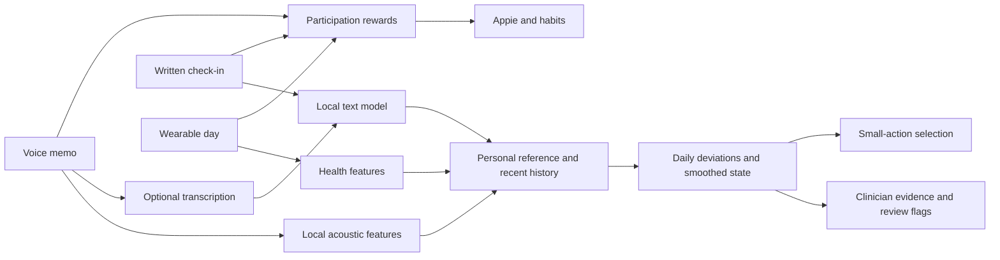

<p align="center">
  
</p>

# Steady · A little, daily

**A daily companion for people after depression treatment, and an evidence workspace for their care team.**

Steady combines a short voice or written check-in, wearable measurements and a personal reference to make changes across days easier to inspect. Appie, the companion above, makes taking part feel warm and rewarding. The clinician desktop shows the measurements, references and calculations behind each observation.

Built for **Junction 2026 · Aalto University challenge**. The starting use case is follow-up after transcranial magnetic stimulation, or TMS.

> **Research prototype:** the implemented models and public-dataset experiments are described below. Steady has not been clinically validated to predict relapse after TMS. The local demo uses patient selection rather than production authentication; run it on localhost with demonstration data.

[Run locally](#run-locally) · [Try the demo](#walk-through-the-demo) · [The model engine](#how-the-model-engine-works) · [Research and decisions](docs/RESEARCH.md) · [Function guide](docs/TECHNICAL_GUIDE.md)

## Why Steady?

Finishing treatment does not end the need for support. Research on the durability of rTMS response motivates attention to what happens after the acute course. Steady explores whether small, repeated observations can support a more informed follow-up conversation. [Senova et al., 2019](https://pubmed.ncbi.nlm.nih.gov/30344109/)

The central question is **“What has changed from this person's own usual?”** A naturally quiet voice or introspective writing style should not, by itself, determine a person's state. Steady first collects a personal reference, then measures deviations from it over time. This is the project's design hypothesis; it still needs prospective clinical evaluation.

## What the app does

| Part | What someone can do | Purpose |
|---|---|---|
| **Today** | See Appie, the daily prompt, streak, food and suggested small action. | Bring the daily experience into one place. |
| **Check in** | Read an optional fixed passage, record a roughly 30-second memo, listen back and save; writing is also available. | Collect voice and language observations with a separate, repeatable reading task. |
| **Habits** | Track custom hobbies and supported wearable habits; manage reminders and the Google Health connection. | Make ordinary activities visible and reward participation. |
| **Appie** | Feed and rename the companion, earn levels and unlock appearances. | Give participation a tangible, friendly reward. |
| **Gentle check-ins** | Receive a reviewed message after changes in check-in timing or length. | Offer an approachable route back, including a written alternative. |
| **Circle** | Join by invitation, choose a profile or pseudonym, opt into individual sharing fields and send preset reactions. | Let friends encourage each other while keeping clinical information out of the feed. |
| **Clinician desktop** | Review the cohort, open a patient, inspect entries and trends, manage references and review notifications. | Connect an observation to its measurements and scoring evidence. |
| **Model evidence** | Inspect the configured artifacts, hashes, evaluation reports and limitations. | Make the engine inspectable alongside the interface. |

Food is earned for taking part, not for getting a favourable model score. Spending food does not remove lifetime XP or unlocked levels. A late memo still counts; only the prompt-window bonus changes. Appie's messages use engagement history, not the contents of a diary or the clinical drift score.

See the [patient and Appie walkthrough](docs/APPIE.md) and [clinical workspace walkthrough](docs/CLINICIAN.md) for the full flows.

## Run locally

### Requirements

- **Python 3.13** and **Node.js 22**, with npm.
- Internet access for installing dependencies and the first download of the pretrained voice model. CPU inference is supported; the first voice check-in can be slow while models load.
- A Gemini API key only if you want spoken transcription. Written check-ins and the synthetic clinical demonstration work without it.

Training datasets are **not required to run the demo**. The text classifier and branch configuration artifacts are included in the repository. Install the ML requirements below for the full voice pipeline: the smaller backend requirements file alone is not the complete voice environment.

### Windows / PowerShell

On a fresh clone:

```powershell
git clone https://github.com/Kasperengeset/Steady.git
cd Steady
py -3.13 -m venv backend/.venv
.\backend\.venv\Scripts\python.exe -m pip install -r backend/requirements-ml.txt tzdata
Copy-Item .env.example .env
Push-Location frontend
npm.cmd ci
Pop-Location
.\scripts\run_local.ps1
```

Keep an existing `.env` when updating a checkout. The launcher starts both services from the same repository, writes logs to `.runs/`, and refuses to replace processes already using the ports. Stop its recorded services with `scripts/stop_local.ps1`. `-NoWarmup` skips the initial voice-model warm-up.

### macOS / Linux

After cloning, from the repository root:

```bash
python3.13 -m venv backend/.venv
backend/.venv/bin/python -m pip install -r backend/requirements-ml.txt tzdata
cp .env.example .env
cd backend
.venv/bin/python -m uvicorn app.main:app --host 127.0.0.1 --port 8000
```

In another terminal, from the repository root:

```bash
cd frontend
npm ci
npm run dev -- --host 127.0.0.1
```

| Open | Address |
|---|---|
| Patient app | <http://localhost:5173/> |
| Clinician desktop | <http://localhost:5173/clinician> |
| API documentation | <http://127.0.0.1:8000/docs> |
| Backend capability check | <http://127.0.0.1:8000/api/health> |

The default database is `data/app.db`, created at startup. If the interface loads but Appie returns **Not Found**, check that the frontend and backend are running from the same current checkout. The health response should identify `api_version: appie-integration-v1`.

### Optional connections

Configure these in the root `.env`; the authoritative names and defaults are in [config.py](backend/app/config.py).

| Feature | Configuration | Behaviour without it |
|---|---|---|
| Spoken transcription | `GEMINI_API_KEY`; optional `TRANSCRIBE_MODEL` and `TRANSCRIBE_LANGUAGE` overrides. | Voice measurements can still run; unavailable transcription does not feed invented text into the text model. |
| Google Health / Fitbit | `GOOGLE_CLIENT_ID`, `GOOGLE_CLIENT_SECRET`, `GOOGLE_REDIRECT_URI`. Register the callback `http://127.0.0.1:8000/api/google-health/callback`. | Use the explicitly labelled generated health sample for demonstration. |
| Web Push | VAPID public/private keys and subject; setup helper: [gen_vapid.py](scripts/gen_vapid.py). | In-app prompt status remains available; device push is not configured. |
| Experimental content ratings | `RATE_TEXT_ENABLED=true` plus Gemini access. | Disabled by default. These ratings currently have zero scoring weight even when enabled. |

The patient chooses notification permission and health connection in the UI. Provider account access and browser/device support are additional prerequisites for those integrations.

## Walk through the demo

1. Open the clinician desktop and press **Demo workspace**. It creates or reopens a separate demonstration profile without resetting existing patients.
2. Open its reference and trend. The drift scenario contains **14 synthetic reference days followed by 10 days of increasing deviation**. Origin labels identify the generated history.
3. Use **Live analysis** to submit an original written check-in. It runs the installed text pipeline and saves a new observation against the synthetic reference.
4. Open that entry in **Entry log**. Inspect the input, raw features, personal centre and scale, signed deviations, branch contributions, artifact identifiers and saved state before/after ingestion.
5. Visit the patient app with `/?p=<patient_id>`, using that profile's ID. Try a memo, habit, Appie feeding and the opt-in circle. The chosen patient is remembered for the browser session.

A new entry may have a modest effect on a smoothed trend; its individual measurements are still inspectable. The desktop refreshes while visible and after submissions.

For scripted setup, `scripts/seed_clinical_demo.py --scenario drift` appends the same isolated story; `stable` and `building` are also supported. The older bulk seed scripts have different purposes and reset controls—use the append-only clinical demo when keeping existing entries.

**What the demonstration proves:** entries are logged, available extractors run, personal comparisons are calculated, and their evidence can be inspected. Synthetic histories and public-dataset results do not establish clinical relapse-detection performance.

## How the model engine works



### Three sources, with different jobs

| Branch | Measurements used | Implementation |
|---|---|---|
| **Acoustic: how the voice sounds** | Six prosodic measurements from openSMILE/eGeMAPS, plus audEERING wav2vec2 arousal and valence. The live drift model uses eight equal weights with correlation normalization. | [prosody.py](backend/app/pipeline/prosody.py), [emotion.py](backend/app/pipeline/emotion.py), [acoustic weights](backend/app/engine/weights/acoustic.json) |
| **Text: how the entry is expressed** | A masked TF-IDF/logistic-regression language score, absolutist-word frequency, first-person language and sentiment. The classifier score carries most of this branch's weight. | [text.py](backend/app/pipeline/text.py), [text weights](backend/app/engine/weights/text.json) |
| **Health: daily rhythms** | Available activity, sleep, resting heart rate and HRV measurements. Some activity features have zero weight; active minutes are engagement-only. Missing measurements are omitted. | [health.py](backend/app/pipeline/health.py), [health weights](backend/app/engine/weights/health.json) |

These training corpora are unpaired, so this is not a jointly trained multimodal neural network. The branches meet through the personal state engine. A pretrained emotion model estimates voice dimensions; Steady's application-level calculation measures change from a reference.

### From observations to a personal trend

1. **Build a reference.** The first observations start a baseline. Defaults are a 14-day collection period, at least 10 observations overall and feature-level coverage requirements. An eligible reference locks automatically; the clinician can review, reject or start a replacement. The app does not establish that a reference period represents clinical remission.
2. **Adjust and compare.** Median-based centres, MAD-based scales and available corpus variability priors reduce dependence on one unusual observation. A fitted baseline hour-of-day adjustment accounts for varying prompt times.
3. **Use two references.** An anchored track retains the locked reference; a rolling track uses recent history. This allows an old reference and recent observations to tell different parts of the story without silently moving the anchor.
4. **Aggregate and smooth.** Features form branch deviations, repeated entries are weighted, and available branches form a daily deviation. An exponentially weighted moving average uses `alpha = 0.3`; the larger reference-track state drives the decision rules. Additional unprompted entries normally have half weight after the first entry in their branch.
5. **Save the evidence.** New check-ins atomically store an analysis snapshot, including reference values, feature shares, entry weights, artifact hashes and state before/after. Opening an entry reads that result rather than running inference again. Older entries without snapshots are labelled as retrospective reconstructions.

In the clinical view, `D` is the daily deviation and `S` is the smoothed state used by the review rules. Positive values follow the installed “worse” directions; negative values point the other way. These are signed, baseline-relative signals—not percentage probabilities of depression. Missing days do not become invented measurements. The fixed passage is checked and stored separately; its measurements currently have **no drift weight**. Optional context-aware Gemini ratings are also **disabled by default and unweighted**.

The [technical guide](docs/TECHNICAL_GUIDE.md) explains the equations, core functions, persistence and API entry points.

### Actions and review flags

The action selector filters a small set of activities using the available signal, then uses **Thompson sampling** to balance trying options and reusing those with helpful feedback. The implemented feedback update uses completion and the person's rating. Incorporating next-day state improvement is still a TODO.

Prototype escalation rules use sustained positive deviations for friend support or clinician review, with a deterministic crisis-phrase route that bypasses trend thresholds. An unusually negative anchored state has a separate clinician-only elevation flag. These rules are inspectable software decisions, not validated clinical cut-offs. The app does not contact emergency services or provide comprehensive crisis detection.

## Research and evidence

| Decision | Evidence behind it |
|---|---|
| Short observations in daily life | Ecological momentary assessment motivates repeated, near-the-moment sampling. The exact 09:00–21:00 window and two-hour bonus window are product settings. [Rationale](docs/RESEARCH.md#daily-check-ins-and-prompts) |
| Repeat the same passage separately | The team's reading/interview analysis found lower within-speaker variability, but did not establish better longitudinal relapse detection. Phrase scoring stays gated. [Rationale](docs/RESEARCH.md#the-fixed-reading-passage) |
| Interpretable voice and language measurements | Established acoustic tools, public-corpus experiments and a reproducible text classifier provide component evidence. [Rationale](docs/RESEARCH.md#voice-and-language) |
| Personal baselines and gradual-change monitoring | Individual references address the project's within-person question; robust statistics and EWMA supply the calculation. Window lengths and alert settings remain prototype choices. [Rationale](docs/RESEARCH.md#personal-reference-and-change-detection) |
| Wearable rhythms | Depresjon activity experiments motivate candidate features; sleep and recovery directions include literature priors. Device transfer remains a limitation. [Rationale](docs/RESEARCH.md#wearable-data) |
| Small actions and adaptive selection | Behavioural activation and adaptive-intervention research motivate the approach; Thompson sampling supplies the selection algorithm. The app's activity policy has not been clinically tested. [Rationale](docs/RESEARCH.md#small-actions-and-adaptive-selection) |
| Appie, food, streaks and a small circle | Engagement research motivates experimentation. The specific avatar, reward amounts and sharing design are unvalidated product hypotheses. [Rationale](docs/RESEARCH.md#engagement-and-social-design) |

### Reported component experiments

| Component | Evaluation | Reported result | Scope |
|---|---|---|---|
| Eight acoustic features | 114 Androids speakers; five speaker-independent folds. | Mean ROC-AUC **0.770 ± 0.076**; pooled out-of-fold AUC 0.743. | Between-person interview classification, not the live personal drift score. [Report](ml/reports/acoustic/summary.md) |
| Masked text classifier | Author-separated train/validation/test; balanced held-out Reddit chunks. | **F1 0.908**, ROC-AUC **0.970**. | Forum-label discrimination; writing genre and context remain confounds. [Report](ml/reports/text/v1.md) |
| Health feature experiment | Depresjon, 55 people; leave-one-person-out evaluation. | Logistic-regression **F1 0.706**, ROC-AUC **0.818**. | Actigraphy classification; the app uses baseline-relative measurements and selected directions. [Report](ml/reports/health/summary.md) |

The metrics describe different tasks and datasets and should not be compared as a leaderboard. Engine simulations exercise assumptions about timing, repeated observations and alert behaviour; they are a separate evidence layer. See the [research guide](docs/RESEARCH.md), [design checks](ml/reports/engine/design_checks.md) and [historical decision log](STATUS.md).

## Code map

| Location | Responsibility |
|---|---|
| `frontend/src/patient/` | Patient screens, recording flow, habits, companion and circle. |
| `frontend/src/clinician/` | Cohort overview, patient workspace, entry inspector and model evidence. |
| `backend/app/pipeline/` | Shared audio, language, phrase and wearable feature extraction. |
| `backend/app/baseline.py`, `backend/app/engine/` | Reference lifecycle, deviations, explanations, action selection and review rules. |
| `backend/app/clinical.py`, `backend/app/explanation.py` | Saved per-entry evidence and longitudinal score explanations. |
| `backend/app/appie.py`, `rewards.py`, `prompt.py` | Companion presentation, food ledger, habits and local-time prompting. |
| `backend/app/routers/` | HTTP contracts, social consent, health connection and clinical endpoints. |
| `ml/`, `ml/reports/` | Reproducible training/evaluation scripts and their reports. |
| `scripts/`, `docs/` | Local launchers, demo tooling, developer and research guides. |

For named functions and their inputs, outputs and relationships, start with [the function guide](docs/TECHNICAL_GUIDE.md). Earlier design proposals remain in [plan.md](docs/plan.md); they should be read alongside the current implementation.

## Validation

From `backend`, using its activated virtual environment:

```bash
python -m pip install -r requirements-dev.txt
python -m pytest -q -p no:cacheprovider
```

From `frontend`:

```bash
node --test scripts/test-recording.mjs scripts/test-push.mjs scripts/test-clinical.mjs
npm run build
```

The backend test setup uses a temporary database and disables Gemini calls, model warm-up and background health sync. Coverage includes reward/retry idempotency, social-field isolation, saved scoring evidence and demo preservation. Device microphone permissions, real OAuth consent and push delivery also need a manual pass; passing software tests does not validate clinical effectiveness.

## Data, privacy and licensing

Transcripts, extracted measurements and clinical snapshots are persisted locally in SQLite. Raw uploaded recordings are temporary and deleted after extraction. When configured, transcription sends audio to Gemini; the implementation uses inline requests with `store=False`. This is not a claim that the entire system or provider has no retention.

The circle builds its responses from explicit sharing fields. Scores, transcripts, recordings and wearable measurements do not belong in that feed. A pseudonym affects the social presentation, not the clinician's patient identity. Production sign-in, clinical-role authorization, storage hardening and deployment governance remain future work.

Keep credentials, OAuth tokens, recordings, personal data and training datasets out of Git. The optional [pre-commit hook](scripts/git-hooks/pre-commit) can be enabled with `git config core.hooksPath scripts/git-hooks`.

Project code is covered by [MIT](LICENSE). Datasets and pretrained models retain their own terms: the [Androids Corpus](https://github.com/androidscorpus/data) restricts use and redistribution, and the [audEERING model](https://huggingface.co/audeering/wav2vec2-large-robust-12-ft-emotion-msp-dim) is CC BY-NC-SA 4.0. An MIT code licence does not grant commercial rights to those resources.
