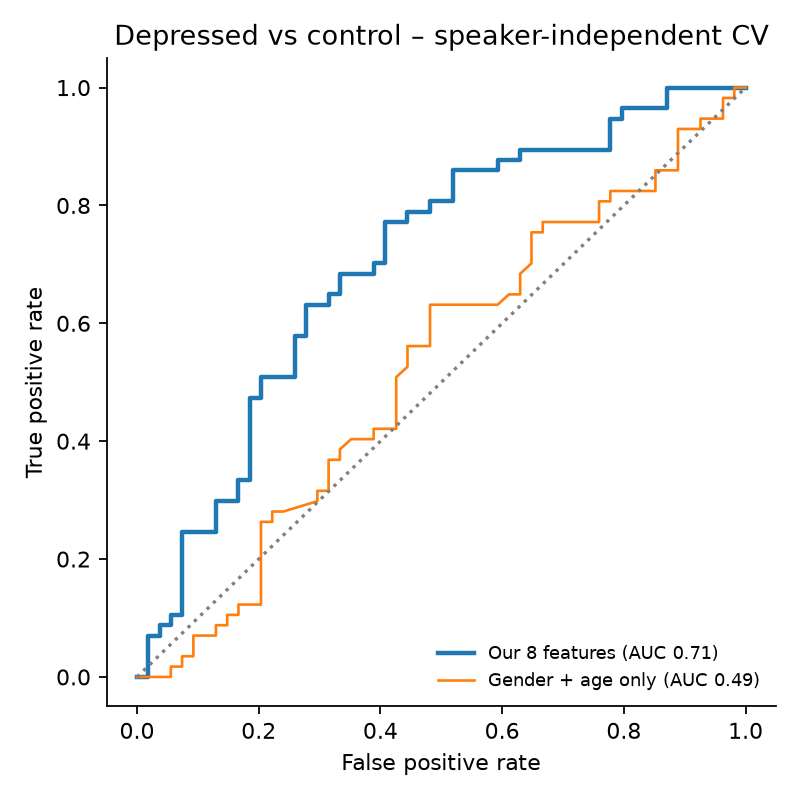
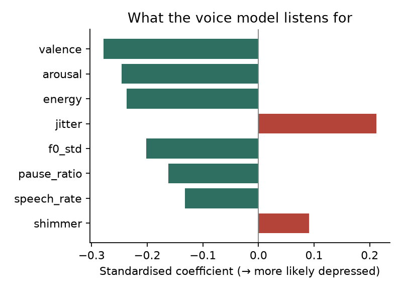

# Acoustic branch – training summary

Trained 2026-11-14T15:13:56+00:00 on `androids_reading` · 111 speakers (57 depressed) · folds: corpus fold-lists.csv (100% of speakers)

## 1. Do the features carry depression signal? (between-person classifier)

| Model | AUC (mean ± sd over folds) | Pooled out-of-fold |
|---|---|---|
| Our 8 features | 0.707 ± 0.125 | 0.705 |
| Gender + age only | 0.488 ± 0.133 | 0.525 |

Standardised logistic-regression coefficients (+ = higher value → more likely depressed):

| Feature | β | Classifier weight | vs. literature |
|---|---|---|---|
| `valence` | -0.279 | 0.179 | agrees |
| `arousal` | -0.246 | 0.158 | agrees |
| `energy` | -0.237 | 0.152 | agrees |
| `jitter` | +0.212 | 0.136 | agrees |
| `f0_std` | -0.202 | 0.129 | agrees |
| `pause_ratio` | -0.162 | 0.104 | ⚠️ sign flips (collinearity) |
| `speech_rate` | -0.133 | 0.085 | agrees |
| `shimmer` | +0.091 | 0.058 | agrees |

## 2. Weights the app uses: change detection (within-person units)

The app compares a person with their own baseline, so weights come from how far depression shifts each
feature relative to one person's clip-to-clip variation, accounting for correlated features
(`ml/change_weights.py`). **Used: `equal`** – on held-out folds all weightings tie within noise,
so the simplest one without fitting is used. Fisher (sign-constrained, shrinkage 0.1) is kept for reference.

| Feature | δ (group difference / within-person SD) | **Weight in app** | Classifier weight | Fisher weight |
|---|---|---|---|---|
| `energy` | -1.88 | **0.125** | 0.152 | -1.598 |
| `arousal` | -1.67 | **0.125** | 0.158 | -1.139 |
| `valence` | -0.60 | **0.125** | 0.179 | -0.216 |
| `f0_std` | -0.37 | **0.125** | 0.129 | -0.330 |
| `speech_rate` | -0.32 | **0.125** | 0.085 | -0.100 |
| `pause_ratio` | -0.13 | **0.125** | 0.104 | +0.000 |
| `jitter` | +0.08 | **0.125** | 0.136 | +0.038 |
| `shimmer` | +0.03 | **0.125** | 0.058 | +0.154 |

**Detectability** = expected shift of the score D (noise SD = 1) for a full control→patient change.
Held-out = weights fitted on 4 folds, evaluated on the 5th fold's speakers.

| Weighting | In-sample | Held-out mean | Held-out per fold |
|---|---|---|---|
| equal | 1.54 | 1.69 | [1.862, 2.089, 0.546, 3.479, 0.464] |
| classifier | 1.72 | 1.46 | [1.831, 1.847, 0.448, 2.826, 0.359] |
| per_feature | 2.21 | 2.17 | [2.068, 2.359, 0.827, 4.805, 0.787] |
| fisher | 2.25 | 2.02 | [2.115, 1.287, 0.9, 5.03, 0.761] |

Caveat: within-person SD comes from clips of one session, so real day-to-day noise is larger and real
detectability lower.

 

**Limitations:** between-person classifier used as a prior for within-person change · small sample · Italian speech (prosody transfers; content is handled by the text branch).
