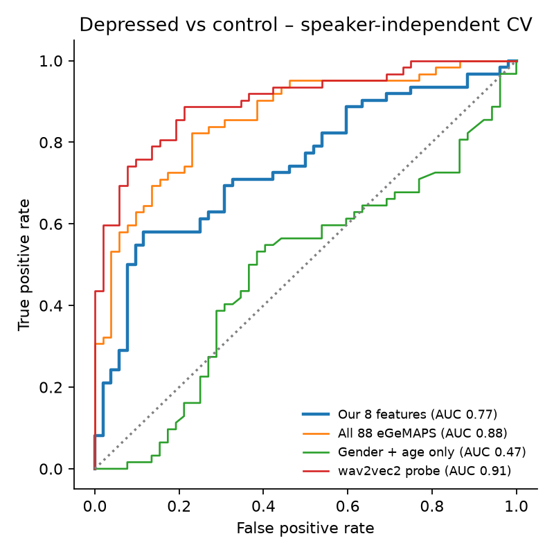

# Acoustic branch – training summary

Trained 2026-11-14T08:26:43+00:00 on `androids_interview` · 114 speakers (62 depressed) · folds: corpus fold-lists.csv (100% of speakers)

## Speaker-independent AUC

| Model | AUC (mean ± sd over folds) | Pooled out-of-fold |
|---|---|---|
| Our 8 features | 0.770 ± 0.076 | 0.743 |
| All 88 eGeMAPS | 0.877 ± 0.055 | 0.860 |
| Gender + age only | 0.475 ± 0.161 | 0.485 |
| wav2vec2 probe | 0.905 ± 0.061 | 0.901 |

## Coefficients (standardised; + = higher value → more likely depressed)

| Feature | β | Weight in app | vs. literature |
|---|---|---|---|
| `arousal` | -0.314 | 0.177 | agrees |
| `jitter` | +0.312 | 0.176 | agrees |
| `valence` | -0.307 | 0.173 | agrees |
| `energy` | -0.244 | 0.138 | agrees |
| `f0_std` | -0.224 | 0.126 | agrees |
| `shimmer` | +0.184 | 0.104 | agrees |
| `speech_rate` | -0.127 | 0.072 | agrees |
| `pause_ratio` | -0.062 | 0.035 | ⚠️ sign flips (collinearity) – literature direction kept |

 

**Limitations:** between-person classifier used as a prior for within-person change · small sample · Italian speech (prosody transfers; content is handled by the text branch).
