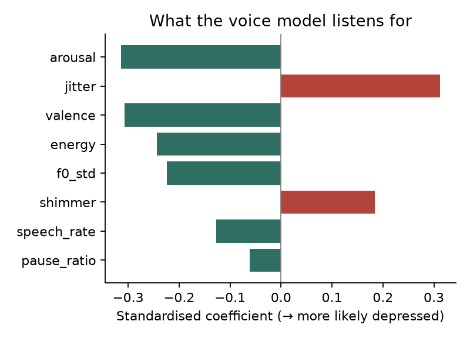

# Acoustic branch – training summary

Trained 2026-11-14T09:18:35+00:00 on `androids_interview` · 114 speakers (62 depressed) · folds: corpus fold-lists.csv (100% of speakers)

## 1. Do the features carry depression signal? (between-person classifier)

| Model | AUC (mean ± sd over folds) | Pooled out-of-fold |
|---|---|---|
| Our 8 features | 0.770 ± 0.076 | 0.743 |
| All 88 eGeMAPS | 0.877 ± 0.055 | 0.860 |
| Gender + age only | 0.475 ± 0.161 | 0.485 |
| wav2vec2 probe | 0.905 ± 0.061 | 0.901 |

Standardised logistic-regression coefficients (+ = higher value → more likely depressed):

| Feature | β | Classifier weight | vs. literature |
|---|---|---|---|
| `arousal` | -0.314 | 0.177 | agrees |
| `jitter` | +0.312 | 0.176 | agrees |
| `valence` | -0.307 | 0.173 | agrees |
| `energy` | -0.244 | 0.138 | agrees |
| `f0_std` | -0.224 | 0.126 | agrees |
| `shimmer` | +0.184 | 0.104 | agrees |
| `speech_rate` | -0.127 | 0.072 | agrees |
| `pause_ratio` | -0.062 | 0.035 | ⚠️ sign flips (collinearity) |

## 2. Weights the app uses: change detection (within-person units)

The app compares a person with their own baseline, so weights come from how far depression shifts each
feature relative to one person's clip-to-clip variation, accounting for correlated features
(`ml/change_weights.py`). **Used: `equal`** – on held-out folds all weightings tie within noise,
so the simplest one without fitting is used. Fisher (sign-constrained, shrinkage 0.1) is kept for reference.

| Feature | δ (group difference / within-person SD) | **Weight in app** | Classifier weight | Fisher weight |
|---|---|---|---|---|
| `arousal` | -1.42 | **0.125** | 0.177 | -1.030 |
| `energy` | -1.19 | **0.125** | 0.138 | -0.542 |
| `valence` | -0.88 | **0.125** | 0.173 | -0.220 |
| `jitter` | +0.54 | **0.125** | 0.176 | +0.546 |
| `pause_ratio` | +0.44 | **0.125** | 0.035 | +0.000 |
| `speech_rate` | -0.30 | **0.125** | 0.072 | -0.136 |
| `shimmer` | +0.28 | **0.125** | 0.104 | +0.391 |
| `f0_std` | -0.24 | **0.125** | 0.126 | -0.415 |

**Detectability** = expected shift of the score D (noise SD = 1) for a full control→patient change.
Held-out = weights fitted on 4 folds, evaluated on the 5th fold's speakers.

| Weighting | In-sample | Held-out mean | Held-out per fold |
|---|---|---|---|
| equal | 1.47 | 1.58 | [1.603, 1.492, 0.801, 2.896, 1.108] |
| classifier | 1.59 | 1.58 | [1.32, 1.723, 0.859, 2.841, 1.161] |
| per_feature | 1.54 | 1.61 | [1.324, 1.707, 0.948, 3.142, 0.908] |
| fisher | 1.66 | 1.54 | [1.06, 1.611, 1.025, 3.058, 0.935] |

Caveat: within-person SD comes from clips of one session, so real day-to-day noise is larger and real
detectability lower.

 

**Limitations:** between-person classifier used as a prior for within-person change · small sample · Italian speech (prosody transfers; content is handled by the text branch).
